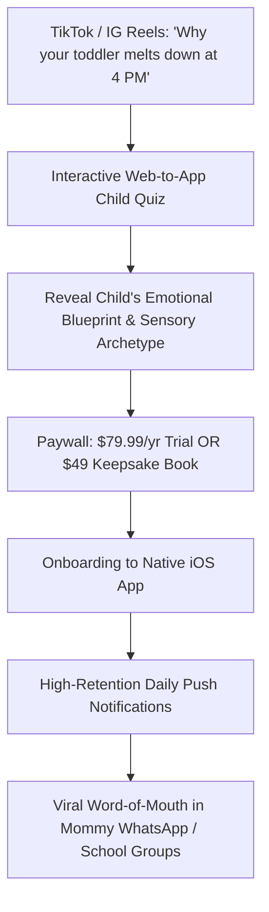

# 🌿 KINDRED (The Inborn Child Blueprint)
### End-to-End Master Product, Business & Technical Plan
*Targeting Affluent Parents in Tier-1 Markets: US, UK, Canada, Australia & Germany*

---

## 1. Brand Identity & Name Selection

### The Naming Decision
We are retiring "Kinship" in favor of names that feel warm, editorial, scientific-soulful, and prestigious.

| Name Candidate | Brand Vibe & Persona | Why It Works in US / UK / AU / DE |
| :--- | :--- | :--- |
| **1. KINDRED** *(Recommended Hero)* | Intimate, warm, rooted in genetic & soul resonance. | Evokes *"kindred spirits"*; feels like an upscale Scandinavian parenting brand (like Stokke or Bugaboo). |
| **2. LUMEN CHILD** (or **LUMEN**) | Clean, luminous, architectural, Montessori. | *"Lumen"* means light/brilliance; positions the app around unlocking the child’s inner brilliance. |
| **3. INNATE** | Clinical, biohacking, psychological. | Appeals heavily to high-income parents who follow Andrew Huberman, neurodiversity research, and somatic health. |
| **4. STARLING** | Poetic, protective, gentle. | Evokes a baby bird and the cosmos; fits the nursery aesthetic and baby-shower gifting economy. |
| **5. SOLA BABY** | Earthy, warm, solar. | Easy to pronounce across English, German, and French; high recall. |

> **Working Hero Brand Name:** **KINDRED**  
> **Brand Tagline:** *"Understand your child’s inborn nature before the world tells them who to be."*  
> **Design Vibe:** Warm editorial minimalism (Kinfolk, Apple Health, Montessori). Neutral linen, muted sage, terracotta, warm oatmeal tones. Zero dark-purple crystal-ball clutter.

---

## 2. The "Neuro-Vedic" Translation Engine

Tier-1 parents in the US, UK, Canada, Germany, and Australia will **never** buy superstitious fortune-telling or fatalistic claims about their baby. However, they are **obsessed** with understanding their child’s unique nervous system, learning style, and emotional regulation.

We translate ancient Vedic mathematical frameworks into modern child developmental psychology:

```
┌───────────────────────────────────────┬────────────────────────────────────────────────────────┐
│ ANCIENT VEDIC JYOTISH ENGINE          │ MODERN TRANSLATION FOR AFFLUENT PARENTS                │
├───────────────────────────────────────┼────────────────────────────────────────────────────────┤
│ Child's Moon Nakshatra                │ 🧠 The Emotional Nervous System & Self-Soothing Profile│
│ (27 Lunar Mansions)                   │ (How your child processes stress, fear, and comfort)   │
├───────────────────────────────────────┼────────────────────────────────────────────────────────┤
│ 5th House & Mercury Placements        │ 🎨 Inborn Learning Modality & Cognitive Genius         │
│ (Buddhi & Vidya Bhava)                │ (Visual, Tactile, STEM-Analytical, or Intuitive-Art)   │
├───────────────────────────────────────┼────────────────────────────────────────────────────────┤
│ 1st House (Lagna) & Mars / Sun        │ ⚡ Somatic Energy, Sleep Rhythm & Sensory Tolerance   │
│ (Tanu Bhava)                          │ (High-stimulus sensitivity vs. grounding physical need)│
├───────────────────────────────────────┼────────────────────────────────────────────────────────┤
│ Parent-Child Synastry                 │ 🪞 The Trigger & Attachment Mirror                     │
│ (Moon-to-Moon, Saturn-to-Moon)        │ (Why your child triggers you, with verbal scripts)     │
├───────────────────────────────────────┼────────────────────────────────────────────────────────┤
│ Child's Dasha Cycle                   │ ⏳ Developmental Growth Seasons                        │
│ (Planetary Chapters)                  │ (e.g., "The Independence Sprint: Ages 2 to 4")        │
└───────────────────────────────────────┴────────────────────────────────────────────────────────┘
```

---

## 3. Target Consumer & Geographic Deep-Dive

### Target Persona: "The Conscious Tier-1 Mother & Parent"
* **Demographics:** Women (78%) and Men (22%) aged 26–42.
* **Geographies:** 
  * **United States:** Coastal cities (Bay Area, LA, Brooklyn, Austin, Seattle).
  * **United Kingdom:** London, Cotswolds, Surrey, Edinburgh.
  * **Canada:** Vancouver, Toronto.
  * **Australia:** Byron Bay, Sydney Northern Beaches, Melbourne.
  * **Germany / DACH:** Munich, Berlin, Zurich (high Waldorf/Montessori adoption).
* **Household Income:** \$120,000 – \$350,000+.
* **Core Anxieties / Desires:**
  * Exhausted by generic parenting books (*"Every book says to sleep train, but my baby screams for 3 hours"*).
  * Worried about neurodivergence, sensory processing disorder, or ADHD.
  * Guilt over losing their temper when their toddler has a meltdown.
  * Desperate to provide tailored schooling and extracurriculars matching their child's natural gifts.

---

## 4. Complete Product Architecture (Core Features)

```
                                  KINDRED APP ARCHITECTURE
                                             │
         ┌───────────────────────────────────┼───────────────────────────────────┐
         ▼                                   ▼                                   ▼
┌──────────────────┐               ┌──────────────────┐                ┌──────────────────┐
│ 1. Inborn Child  │               │ 2. Parent-Child  │                │ 3. Daily Rhythm  │
│    Blueprint     │               │    Harmony Engine│                │    & Energy      │
├──────────────────┤               ├──────────────────┤                ├──────────────────┤
│• Emotional       │               │• Trigger Mirror  │                │• Today's Sensory │
│  Sensory Profile │               │• Exact verbal    │                  Weather (0-100)  │
│• Learning Style  │                 scripts for      │                │• Optimal sleep / │
│• Creative vs STEM│                 tantrums         │                  stimulation hours│
│  Genius Mapping  │               │• Co-parent bond  │                │• 1 Daily Micro-  │
│                  │                 comparison       │                  Connection Habit │
└──────────────────┘               └──────────────────┘                └──────────────────┘
                                             │
         ┌───────────────────────────────────┴───────────────────────────────────┐
         ▼                                                                       ▼
┌──────────────────┐                                                   ┌──────────────────┐
│ 4. "The Doula"   │                                                   │ 5. The Keepsake  │
│    AI Companion  │                                                   │    Gift Engine   │
├──────────────────┤                                                   ├──────────────────┤
│• 24/7 Context-   │                                                   │• Physical Custom │
│  aware parenting │                                                     Hardcover Book   │
│  coach (knows    │                                                   │• PDF Soul Dossier│
│  child's chart)  │                                                   │• Babylist Registry│
└──────────────────┘                                                   └──────────────────┘
```

### Module 1: The Inborn Child Blueprint
* **The Emotional Regulation Profile:** Explains how the child experiences the world. (e.g., *"Rohini Moon: High sensory sensitivity, easily overwhelmed by synthetic fabrics and loud noises; thrives with calming ambient lighting and physical cuddles"*).
* **The Cognitive & Learning Modality Map:** Details how to teach them. (e.g., *"Mercury in Gemini: Verbal processor who learns through storytelling and conversational debate, not silent memorization"*).
* **The Innate Strength Archetype:** e.g., *"The Architect"*, *"The Peacemaker"*, *"The Deep Feeling Pioneer"*.

### Module 2: The Parent-Child Trigger Mirror (Synastry)
* **The Clash Diagnostic:** Analyzes why you clash with your child. (e.g., *"You have a fiery, fast-paced Aries Moon; your daughter has a deliberate, earthy Taurus Moon. When you rush her to put shoes on, it registers in her nervous system as danger, causing a freeze/meltdown"*).
* **Gentle-Parenting Scripts:** Instant word-for-word phrases to defuse friction based on their astrological-psychological dynamic.

### Module 3: Daily Sensory Weather & Meltdown Risk
* **Daily Sensory Forecast (0–100):** Based on real-time lunar transits over the child's natal chart.
* **High-Stimulus Windows:** Flags hours when taking the toddler to a crowded grocery store or birthday party will likely cause an overstimulation meltdown.
* **Daily Micro-Connection Ritual:** One simple, 3-minute evening ritual tailored to ground the child’s nervous system.

### Module 4: "The Doula" — AI Pediatric Soul Coach
* Powered by Google Gemini 1.5 Pro with prompt-caching containing:
  1. The child's complete birth chart (planets, signs, nakshatras, houses).
  2. The parent's birth chart.
  3. Evidence-based gentle parenting frameworks (Dr. Becky Kennedy, Janet Lansbury, Montessori).
* **Use Case:** A mother typing at 2:00 AM: *"My 3-year-old refused to sleep and threw his toys at me. What do I do?"* $\rightarrow$ The Doula analyzes the current transit against the child's emotional chart and provides immediate, empathetic, step-by-step de-escalation guidance.

---

## 5. Monetization & High-Ticket Gifting Engine

Affluent parents in Tier-1 countries have the **highest gifting spend** in consumer tech. We monetize via two complementary pillars:

```
                                  REVENUE ARCHITECTURE
                                            │
         ┌──────────────────────────────────┴──────────────────────────────────┐
         ▼                                                                     ▼
┌─────────────────────────────────┐                   ┌─────────────────────────────────┐
│     IN-APP SUBSCRIPTION         │                   │      HIGH-TICKET GIFT ENGINE    │
├─────────────────────────────────┤                   ├─────────────────────────────────┤
│ • $79.99 / Year (Hero Offer)    │                   │ • $49.00 Personalized PDF       │
│   (Includes 3-day free trial)   │                     Comprehensive Soul Blueprint    │
│ • $14.99 / Month (Anchor)       │                   │ • $89.00 Physical Custom Linen  │
│ • Multi-Child Family Add-on     │                     Hardcover Keepsake Book         │
│   (+$29/yr per additional child)│                   │ • Baby Registry Integration     │
└─────────────────────────────────┘                   └─────────────────────────────────┘
```

### The Physical Keepsake Book (Print-on-Demand Goldmine)
* **The Product:** A stunning, 42-page custom linen-bound, gold-foil stamped coffee table book titled: *"The Inborn Nature of [Child’s Name]"*.
* **Unit Economics:**
  * Retail Price: **\$89.00** + shipping.
  * Print-on-Demand Cost (via Prodigi or Gelato API): **\$18.50**.
  * **Gross Margin: ~78% (\$70.50 profit per book).**
* **Distribution Channel:** Babylist Registry, Amazon Baby Registry, Pinterest, and grandparent/godparent gifting.

---

## 6. Go-To-Market (GTM) Playbook for US/UK/CA/AU/DE



### Channel 1: The "Mom-Tok" & Instagram Reels Organic Engine
* **Format:** Relatable, non-judgmental video hooks for exhausted parents:
  * *"Why gentle parenting fails if your child has a Scorpio Moon (and the 1 script that actually works)."*
  * *"The reason your second child is completely unbothered while your first child melts down over sock seams."*
* **Conversion:** Links directly to the free **Inborn Child Quiz**.

### Channel 2: Postpartum Doulas & Sleep Consultants Affiliate Program
* Partner with high-end postpartum doulas, pediatric sleep coaches, and lactation consultants in Tier-1 cities.
* Offer **30% recurring rev-share** or white-labeled reports they can gift their high-net-worth clients.

### Channel 3: Baby Registry Gifting Engine
* Integrate with **Babylist.com** (the dominant baby registry in the US) as a featured digital/physical gift option for expecting mothers.

---

## 7. Technical Architecture & Tech Stack

```
[Flutter / SwiftUI Mobile App]   <───>   [FastAPI Python Backend]
                                                │
                 ┌──────────────────────────────┼──────────────────────────────┐
                 ▼                              ▼                              ▼
      [Swiss Ephemeris Worker]         [Supabase PostgreSQL]          [Gemini 1.5 Pro AI]
      • pyswisseph (Lahiri)            • User Profiles / Charts       • Prompt-Cached Child
      • Nakshatra & Dasha math         • Parent-Child Relations         & Parent Context
      • Synastry aspect engine         • Push Notification queue      • "The Doula" Chat
```

* **Frontend:** Flutter (cross-platform iOS & Android) with an **iOS-first** design focus.
* **Astrological Engine:** Python with `pyswisseph` (Swiss Ephemeris C-bindings) calculating Sidereal longitudes using **Lahiri Ayanamsa**.
* **Database & Auth:** Supabase (PostgreSQL with PostGIS for automatic latitude/longitude and historical timezone lookups via TimeZoneDB).
* **Subscriptions:** RevenueCat (iOS In-App Purchases) + Stripe (for Web-to-App quiz funnels).
* **Child Privacy Compliance:** Strict **COPPA** (US) and **GDPR-K** (Europe) compliance: No sensitive child tracking or data selling; all child chart records encrypted at rest.

---

## 8. 12-Week Execution Roadmap (0 to Launch)

```
Weeks 1 - 2: Core Engine & Ephemeris Setup
├─ Build Python Swiss Ephemeris micro-service for child Nakshatras & 5th house calculations.
├─ Write the complete Neuro-Vedic translation JSON dictionary (Nakshatras -> Sensory profiles).
└─ Create the prompt architecture and testing suite for "The Doula" AI.

Weeks 3 - 5: Web Onboarding Quiz & Pre-Orders
├─ Build high-converting Next.js quiz ("Discover Your Child's Inborn Blueprint").
├─ Integrate Stripe and pre-order checkout for the $49 Digital Keepsake PDF.
└─ Run $50/day test ads on Meta & Pinterest targeting US mothers to optimize CAC.

Weeks 6 - 8: Native iOS Mobile App Build
├─ Build Flutter/SwiftUI app with warm Montessori/Kinfolk design tokens.
├─ Implement Child Profile Screen, Daily Sensory Forecast, and Parent-Child Synastry Screen.
└─ Integrate RevenueCat for subscription billing ($79.99/year).

Weeks 9 - 10: Print-on-Demand Hardcover Integration
├─ Design the 42-page automated PDF generator for the physical keepsake book.
├─ Connect Gelato / Prodigi API for automated global on-demand printing & dropshipping.
└─ Private Beta testing with 50 affluent US/UK mothers.

Weeks 11 - 12: Public Launch in US, UK, Canada & Australia
├─ Official Apple App Store public release.
├─ Scale TikTok / Instagram Mom-Tok content engine.
└─ Launch Doula / Sleep Consultant affiliate portal.
```
