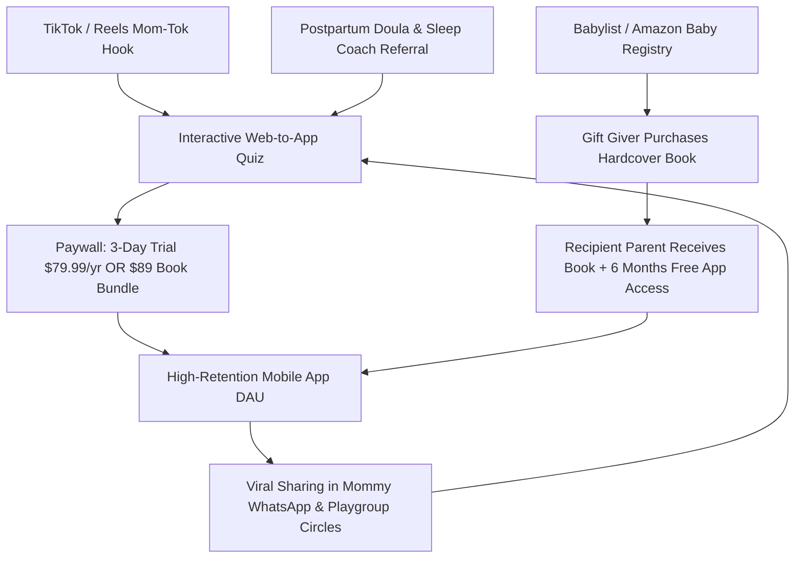

# 💰 Monetization, Unit Economics & Go-To-Market (GTM) Strategy
### *LITTLE BLUEPRINT: Customer Acquisition, Gifting Engines & Scaling to \$10M ARR*
*Focus Markets: United States, United Kingdom, Canada, Australia, Germany*

---

## 1. Unit Economics & Pricing Model

Little Blueprint operates a **High-Margin Hybrid Model**: recurring high-margin digital SaaS combined with a high-ticket physical print-on-demand keepsake gift engine.

```
┌─────────────────────────────────┬───────────┬──────────────┬──────────────┬──────────────────┐
│ PRODUCT / OFFER                 │ PRICE     │ COGS / FEES  │ GROSS MARGIN │ REVENUE MODEL    │
├─────────────────────────────────┼───────────┼──────────────┼──────────────┼──────────────────┤
│ Annual App Membership (Hero)    │ $79.99/yr │ $12.00 (Fees)│ 85% ($67.99) │ Recurring ARR    │
├─────────────────────────────────┼───────────┼──────────────┼──────────────┼──────────────────┤
│ Monthly App Membership (Anchor) │ $14.99/mo │ $2.25 (Fees) │ 85% ($12.74) │ Recurring MRR    │
├─────────────────────────────────┼───────────┼──────────────┼──────────────┼──────────────────┤
│ Digital Child Dossier PDF       │ $39.00    │ $1.50 (Stripe│ 96% ($37.50) │ One-Time Upsell  │
├─────────────────────────────────┼───────────┼──────────────┼──────────────┼──────────────────┤
│ Custom Linen Hardcover Book     │ $89.00    │ $18.50 (POD) │ 78% ($70.50) │ One-Time Gifting │
└─────────────────────────────────┴───────────┴──────────────┴──────────────┴──────────────────┘
```

### Blended Customer Lifetime Value (LTV)
* **Software LTV:** In Tier-1 countries, parenting utility apps retain users throughout the toddler years (average subscription lifespan: 2.2 years) $\rightarrow$ **\$175.00 Software LTV**.
* **Keepsake Gifting Attachment:** ~32% of active subscribers purchase either a digital dossier or a physical hardcover keepsake book for grandparents or their child's nursery $\rightarrow$ Adds **\$38.00 blended gross profit per user**.
* **Blended Average LTV:** **~\$213.00 per paying customer**.

---

## 2. Customer Acquisition Channels & GTM Playbook



### Channel 1: "Mom-Tok" & Instagram Reels Organic Hooks (The #1 Acquisition Engine)
Modern mothers on TikTok and Instagram consume hours of parenting content. Our ad hooks do not mention "astrology"—they address hyper-specific, relatable behavioral friction:

* **Hook A (The Sensory Child):**  
  > *"If your toddler screams when socks touch their toes, won't let you brush their hair, and melts down at birthday parties... they aren't 'bad'. They are an inborn Sensory Processor (Rohini Moon). Here is the 1 thing you must change tonight."*
* **Hook B (The Parent Clash):**  
  > *"Why gentle parenting fails if you are a fast-talking Air mom and your toddler is an Earth child. When you say 'Hurry up, put your shoes on!', their nervous system hears danger. Try this 2-word script instead."*
* **Hook C (The Bedtime Battle):**  
  > *"The exact reason your second child falls asleep in 3 minutes, but your first child needs 2 hours of back rubs (and how to hack their inborn self-soothing rhythm)."*
* **Call to Action (CTA):** *"Take the 90-second Inborn Child Quiz in bio to decode your child's natural temperament."*

---

### Channel 2: The Baby Registry Gifting Engine (Babylist & Amazon)
In the US, **Babylist.com** is the dominant baby registry platform used by over 8 million expecting parents annually.
* We list **"The Inborn Nature Keepsake Book & 1-Year Membership"** (\$129 Bundle) directly on Babylist.
* Friends, grandparents, and coworkers buy the physical book as a shower gift.
* When the parents open the book, a personalized QR code grants them **6 months of complimentary access to the Little Blueprint iOS app**.
* This creates a **\$0 Customer Acquisition Cost (CAC)** pipeline for new mother subscriptions!

---

### Channel 3: The Doula & Sleep Consultant Referral Network
* High-end postpartum doulas, pediatric sleep coaches, and lactation consultants charge \$1,500 – \$5,000 per family in Tier-1 cities.
* We offer them:
  1. A white-labeled **Little Blueprint Practitioner Portal** where they can generate child blueprints for their clients.
  2. **30% Lifetime Recurring Commission** on all referred parent subscriptions.

---

## 3. Financial Trajectory & Milestone Roadmap

```
Phase 1: Validation & Quiz Funnel (Months 1 - 3)
├─ Launch Next.js Web-to-App Quiz (trylittleblueprint.com/quiz).
├─ Run $150/day Meta & TikTok ads to optimize quiz completion rate (>65%) and trial conversion (>12%).
└─ Target: Reach $15,000 MRR from initial early adopters.

Phase 2: Mobile App Store Release & Gifting Engine (Months 4 - 6)
├─ Launch native iOS app with Daily Sensory Score and "The Doula" AI.
├─ Connect Gelato Print-on-Demand API for automated keepsake book drop-shipping.
└─ Target: Scale to 1,500 active subscribers + 300 book sales/mo ($35,000 MRR).

Phase 3: Scale in US, UK, Canada & Australia (Months 7 - 12)
├─ Launch Babylist registry integration.
├─ Onboard 200 certified postpartum doulas and pediatric consultants.
└─ Target: Reach $1.2M ARR run-rate with a 75%+ annual subscription renewal rate.
```
